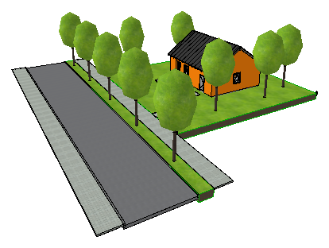
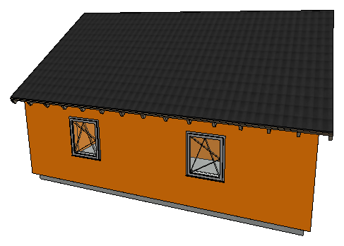
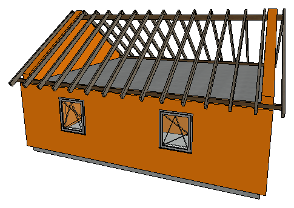

# ELMonkey + Archicad skill for Claude Code

**EN** — Let Claude work inside a running Archicad project: build and change model and 2D elements, classify in bulk, set properties, check and read everything back. Two parts: the **ELMonkey add-on** (Archicad 27/28/29/30, Mac + Windows, with [Tapir](https://github.com/ENZYME-APD/tapir-archicad-automation) built in) and the **Claude Code skill** in this repo, connected through the bundled MCP server `elmonkey-mcp`.

**DE** — Claude arbeitet direkt im laufenden Archicad-Projekt: Modell- und 2D-Elemente erstellen und ändern, in Masse klassifizieren, Eigenschaften setzen, alles prüfen und zurücklesen. Zwei Teile: das **ELMonkey-Add-On** (Archicad 27/28/29/30, Mac + Windows, [Tapir](https://github.com/ENZYME-APD/tapir-archicad-automation) eingebaut) und der **Claude-Code-Skill** in diesem Repo, verbunden über den mitgelieferten MCP-Server `elmonkey-mcp`.

Live-verified on real BIM projects (Teamwork and solo, AC29). Built on Tapir 1.7.2. · Live erprobt an echten BIM-Projekten (Teamwork und Solo, AC29). Basis: Tapir 1.7.2.

---

## Demo — a house built entirely through the API · ein Haus komplett per API

| Site · Grundstück | House · Haus | Without roof skin · ohne Dachhaut |
|:---:|:---:|:---:|
|  |  |  |

**EN** — Built by Claude on 20 Oct 2026 in an empty Archicad 29 project, using only ELMonkey commands — no manual clicks. Every write was read back and checked against the planned values (heights to the millimetre).

- Ground slab, walls, ceiling, doors and windows from office favorites, rooms (zones) detected automatically
- Purlin roof as real structure: eaves purlins 14/14, ridge purlin 16/24, 30 rafters 8/20 at 35°, roof skin as composite "Oberdach ohne Sparren 8,5 cm", gable walls trimmed to the roof planes (solid element operations)
- Site in 3D: terrain mesh, street, sidewalk, green strip, curbs, trees, plot zone, boundary stones and boundary line
- Building materials (glulam purlins, solid-timber rafters) and the built-in property "Load-bearing" set per element

**DE** — Am 20.10.2026 von Claude in einem leeren Archicad-29-Projekt gebaut, ausschließlich mit ELMonkey-Befehlen, ohne einen Klick von Hand. Jede Schreibung wurde zurückgelesen und gegen die geplanten Werte geprüft (Höhen auf den Millimeter).

- Bodenplatte, Wände, Decke, Türen und Fenster aus Büro-Favoriten, Räume (Zonen) automatisch erkannt
- Pfettendach als echte Konstruktion: Fußpfetten 14/14, Firstpfette 16/24, 30 Sparren 8/20 mit 35°, Dachhaut als Mehrschicht „Oberdach ohne Sparren 8,5 cm“, Giebelwände per Solid-Operation an die Dachflächen angeschlossen
- Außenanlage in 3D: Geländenetz, Straße, Gehweg, Grünstreifen, Bordsteine, Bäume, Grundstücks-Zone, Grenzsteine und Grenzlinie
- Baustoffe (Brettschichtholz-Pfetten, Vollholz-Sparren) und die eingebaute Eigenschaft „Tragende Funktion“ je Element gesetzt

Step-by-step recipe with all pitfalls · Schritt-für-Schritt-Rezept mit allen Fallen: [`recipes/gebaeude-und-aussenanlage.md`](recipes/gebaeude-und-aussenanlage.md)

---

## Install · Installation

| Part · Teil | What · Was | How · Wie |
|---|---|---|
| **ELMonkey add-on** | Archicad add-on, Tapir built in (`TapirCommand`) + ELMonkey commands (`ELM_SAB`). Do **not** install Tapir separately. · Tapir eingebaut, Tapir **nicht** zusätzlich installieren. | Installer from the release · Installer aus dem Release |
| **MCP server `elmonkey-mcp`** | Bridge Claude ↔ Archicad, provides `mcp__archicad__*`; reads the live command catalog (`ELM_SAB.ListCommands`), searches in English and German. · Brücke Claude ↔ Archicad, liest den Befehlskatalog live, sucht deutsch und englisch. | `uv tool install …` |
| **Skill** | This repo · dieses Repo | `git clone` + symlink |

**1. ELMonkey** — quit Archicad, then run the installer from the [latest release](https://github.com/mozzi86/-archicad/releases/tag/elm-sab-tapir-latest) · Archicad beenden, dann den Installer aus dem [aktuellen Release](https://github.com/mozzi86/-archicad/releases/tag/elm-sab-tapir-latest) starten:

- **macOS:** [`ELMonkey-Installer-Mac.command`](https://github.com/mozzi86/-archicad/releases/download/elm-sab-tapir-latest/ELMonkey-Installer-Mac.command) (double-click; if blocked: right-click → Open · Doppelklick; falls blockiert: Rechtsklick → Öffnen), or · oder:
  ```bash
  curl -fsSL https://raw.githubusercontent.com/mozzi86/-archicad/main/installer/ELMonkey-Installer-Mac.command | bash
  ```
- **Windows:** [`ELMonkey-Installer-Windows.cmd`](https://github.com/mozzi86/-archicad/releases/download/elm-sab-tapir-latest/ELMonkey-Installer-Windows.cmd) (asks for admin rights · fragt nach Administratorrechten)

The installer finds every Archicad 27/28/29/30, installs the matching bundle and backs up existing ELMonkey/Tapir add-ons to `~/ELM_SAB_Backups/`. Later updates: menu **ELMonkey SAB → About → Check for updates**. · Der Installer findet alle Archicad 27/28/29/30, installiert das passende Bundle und sichert vorhandene ELMonkey-/Tapir-Add-Ons nach `~/ELM_SAB_Backups/`. Updates später: Menü **ELMonkey SAB → Über → Nach Updates suchen**.

**2. MCP server · MCP-Server** (needs · braucht [`uv`](https://docs.astral.sh/uv/)):

```bash
uv tool install "git+https://github.com/mozzi86/-archicad#subdirectory=mcp/elmonkey-mcp"
```

```bash
claude mcp add --scope user archicad -- ~/.local/bin/elmonkey-mcp
```

**3. Skill:**

```bash
git clone https://github.com/mozzi86/-archicad.git ~/.claude/repos/archicad-skill
```

```bash
mkdir -p ~/.claude/skills && ln -s ~/.claude/repos/archicad-skill ~/.claude/skills/archicad
```

Restart Claude Code and ask "Which Archicad instance is running?" · Claude Code neu starten und fragen „Welche Archicad-Instanz läuft?“. Full guide incl. Claude Desktop · Ausführlich inkl. Claude Desktop: [`recipes/initial-setup.md`](recipes/initial-setup.md)

---

## ELMonkey commands · ELMonkey-Befehle (namespace `ELM_SAB`)

44 own commands on top of Tapir's 314 (Tapir 1.7.2). "Since" is the ELMonkey version that added or last changed the command. All write commands read back what Archicad actually stored. · 44 eigene Befehle zusätzlich zu Tapirs 314 (Tapir 1.7.2). „Seit“ ist die ELMonkey-Version, die den Befehl gebracht oder zuletzt geändert hat. Alle schreibenden Befehle lesen zurück, was Archicad wirklich gespeichert hat.

### Model elements · Bauteile

| Command · Befehl | Since · Seit | What it does | Was es macht |
|---|---|---|---|
| `CreatePolygonWalls` | 0.9.0 | Polygon walls from outlines | Polygonwände aus Konturen |
| `CreateRoofs` | 0.9.34 | Single-plane roofs from outline, pivot line (eave) and pitch; structure by composite or building-material name, `layerName`; `thickness` no longer silently ignored on composite tool defaults; read-back of structure and thickness | Ebene Dächer aus Kontur, Pivotlinie (Traufe) und Neigung; Aufbau per Mehrschicht- oder Baustoffname, `layerName`; `thickness` wird bei Mehrschicht-Standard nicht mehr still ignoriert; Rücklese von Aufbau und Dicke |
| `CreateCurtainWallFromAxes` | 0.9.8 | Mullion/transom curtain wall from axis dimensions, also trapezoid/gable and inclined | Pfosten-Riegel-Fassade aus Achsmaßen, auch Trapez/Giebel und geneigt |
| `CreateWallOpenings` | 0.9.21 | Replaces opening placeholder symbols with real wall openings in the host wall, with classification (AC29) | Ersetzt Durchbruch-Symbole durch echte Wandöffnungen in der Wirtswand, mit Klassifizierung (AC29) |
| `SetStructureOfElements` | 0.9.33 | Sets the structure of existing walls, slabs, roofs, shells, columns and beams (basic / composite / profile by name or index) | Setzt den Aufbau bestehender Wände, Decken, Dächer, Schalen, Stützen und Unterzüge (Basis / Mehrschicht / Profil per Name oder Index) |
| `GetConstructionPensOfElements` · `SetConstructionPensOfElements` | 0.10.1 (branch elm-0.10.1-bauteilstifte, CI/live open · Zweig elm-0.10.1-bauteilstifte, CI/live offen) | Read/set pens of walls, columns, beams, slabs, roofs, shells, curtain walls and morphs: cut/contour, uncut and overhead line pens per type, clear the cut-fill pen override (fill back from building material/composite), raw fields; composite skin pens with `includeComposites`; dryRun, Teamwork reservation, one undo step, read-back | Stifte von Wänden, Stützen, Unterzügen, Decken, Dächern, Schalen, Fassaden und Morphs lesen/setzen: Schnitt-/Kontur-, unverdeckte und Überkopf-Linien je Typ, Schnittflächen-Überschreibung löschen (Schraffur wieder aus Baustoff/Verbund), Rohfelder; Verbundschicht-Stifte mit `includeComposites`; dryRun, Teamwork-Reservierung, ein Undo-Schritt, Rücklese |
| `GetSlabLevels` | 0.9.32 | Absolute top/bottom of slabs plus story-relative values, reference plane, thickness | Ober-/Unterkante von Decken absolut und geschossbezogen, Bezugsfläche, Dicke |
| `GetColumnDetails` · `SetColumnDetails` · `SetColumnRotation` | 0.9.5–0.9.6 | Read/set column rotation, origin and core size | Stützen-Drehwinkel, Ursprung und Kernmaße lesen/setzen |
| `SetAddParsOfElements` | 0.9.0 | Sets GDL parameters via memo, crash-safe (also labels) | Setzt GDL-Parameter per Memo, absturzsicher (auch Etiketten) |
| `SetObjectParametersForce` | 0.9.16 | GDL parameters of objects, lamps, labels, zones, doors, windows with a real error code per element; A/B mirrored into the opening size | GDL-Parameter von Objekten, Lampen, Etiketten, Zonen, Türen, Fenstern mit echtem Fehlercode je Element; A/B in die Öffnungsgröße gespiegelt |
| `GetStoryVisibilityOfElements` · `SetStoryVisibilityOfElements` | 0.9.15 | Read/set "Show on stories" of objects and lamps | „Auf Geschossen zeigen“ von Objekten/Lampen lesen/setzen |

### 2D drawing · 2D-Zeichnung

| Command · Befehl | Since · Seit | What it does | Was es macht |
|---|---|---|---|
| `Create2DElements` | 0.9.28 | Creates lines, arcs, circles, polylines, splines and hatches (fill, pens, RGB, contour, holes); the output of `Get2DGeometryOfElements` can be passed back 1:1; read-back incl. length/area | Legt Linien, Bögen, Kreise, Polylinien, Splines und Schraffuren an (Füllung, Stifte, RGB, Kontur, Löcher); die Ausgabe von `Get2DGeometryOfElements` passt 1:1; Rücklese inkl. Länge/Fläche |
| `Modify2DElements` | 0.9.35 | Changes existing 2D elements, GUID stays: layer, pen, line type, remove arrowheads, geometry (polygons keep valid vertex IDs); hatches: fill, foreground/background/contour pen, set/clear RGB, contour line type, fill angle, polygon with holes | Ändert bestehende 2D-Elemente, die GUID bleibt: Ebene, Stift, Linientyp, Pfeilspitzen aus, Geometrie (Polygone mit gültigen Vertex-IDs); Schraffuren: Füllung, Vorder-/Hinter-/Konturstift, RGB setzen/löschen, Konturlinientyp, Winkel, Polygon mit Löchern |
| `Get2DGeometryOfElements` | 0.9.27 | 2D geometry of lines, arcs, circles, polylines, splines, hatches (with sub-polygons); all other types as shape primitives | 2D-Geometrie von Linien, Bögen, Kreisen, Polylinien, Splines, Schraffuren (mit Teilpolygonen); alle anderen Typen als Zeichenprimitive |
| `GetPenOfElements` · `SetPenOfElements` | 0.9.0 | Read/set pens incl. RGB overrides of 2D elements | Stifte inkl. RGB-Overrides von 2D-Elementen lesen/setzen |

### Texts, labels, dimensions · Texte, Etiketten, Maße

| Command · Befehl | Since · Seit | What it does | Was es macht |
|---|---|---|---|
| `GetTextsOfElements` · `SetTextsOfElements` · `SetTextSizeOfElements` | 0.9.0 | Read/replace content of texts and text labels, set text size (mm or factor) | Inhalt von Texten und Text-Etiketten lesen/ersetzen, Schriftgröße setzen (mm oder Faktor) |
| `CreateLabels` · `GetLabelsOfElements` | 0.9.19 | Associative symbol labels (also on another story than the owner, optionally like a template label); list labels per owner | Assoziative Symbol-Etiketten (auch auf anderem Geschoss als der Owner, optional wie ein Vorlage-Etikett); Etiketten je Owner auflisten |
| `GetDimensionDetailsELM` · `CreateDimensionsLikeTemplateELM` · `SetDimensionAppearanceELM` | 0.9.29 | Linear dimensions (also in sections/elevations): read raw data, create like a template, change text size and witness lines | Lineare Maßketten (auch in Schnitt/Ansicht): Rohdaten lesen, wie eine Vorlage anlegen, Schriftgröße und Hilfslinien ändern |
| `GetSectionElementsELM` · `GetInteriorElevationsELM` · `SetInteriorElevationVerticalRangeELM` | 0.9.29 | Raw section elements per section/elevation; interior elevations and their vertical range | Rohe Schnittelemente je Schnitt/Ansicht; Innenansichten und ihr vertikaler Bereich |

### Layers, properties · Ebenen, Eigenschaften

| Command · Befehl | Since · Seit | What it does | Was es macht |
|---|---|---|---|
| `GetLayers` | 0.9.32 | All layers with their real attribute index, hidden/locked/wireframe/xref | Alle Ebenen mit echtem Attribut-Index, ausgeblendet/gesperrt/Drahtmodell/Xref |
| `SetLayerAttributes` | 0.9.32 | Show/hide, lock/unlock, wireframe — by layer name or index | Ein-/ausblenden, sperren/entsperren, Drahtmodell — per Ebenenname oder Index |
| `SetLayerOfElements` | 0.9.19 | Moves elements to a layer (by name or id), with Teamwork reservation | Verschiebt Elemente auf eine Ebene (per Name oder ID), mit Teamwork-Reservierung |
| `ChangePropertyDefinitions` | 0.9.33 | Changes property definitions without a GUID change: append enum values, availability, name, description | Ändert Eigenschafts-Definitionen ohne GUID-Wechsel: Auswahlwerte anhängen, Verfügbarkeit, Name, Beschreibung |

### Search, checks, project · Suche, Prüfung, Projekt

| Command · Befehl | Since · Seit | What it does | Was es macht |
|---|---|---|---|
| `FindElements` | 0.9.23 | Search like "Find & Select": type, story, layer, property, classification, library part, IFC, Teamwork, host/opening, zone, area … nested and/or/not; optional selection | Suche wie „Suchen & Aktivieren“: Typ, Geschoss, Ebene, Eigenschaft, Klassifizierung, Bibliotheksteil, IFC, Teamwork, Wirt/Öffnung, Zone, Bereich … beliebig verschachtelt; optional auswählen |
| `GetElementEditState` | 0.9.17 | Tells per element whether and why it can be edited (hidden/locked layer, hotlink, reserved by others …) | Meldet je Element, ob und warum es änderbar ist (Ebene aus/gesperrt, Hotlink, fremd reserviert …) |
| `GetDeviations` | 0.9.17 | Compares actual dimensions against target values, deviation per axis in mm with tolerance verdict | Vergleicht Ist-Maße mit Sollmaßen, Abweichung je Achse in mm mit Toleranzurteil |
| `SaveProjectCopy` | 0.10.0 | Backup copy of a local project (save + copy); the open project stays the original; saves like Tapir's `SaveProject` (floor plan briefly active), so a project opened read-only is never overwritten; refuses Teamwork/untitled and the original path | Sicherungskopie eines lokalen Projekts (sichern + kopieren); das offene Projekt bleibt das Original; sichert wie Tapirs `SaveProject` (Grundriss kurz aktiv), ein schreibgeschützt geöffnetes Projekt wird nie überschrieben; lehnt Teamwork/unbenannt und den Originalpfad ab |
| `CaptureView` | 0.9.25 | Saves the active window (2D or 3D) as PNG — visual check for agents | Speichert das aktive Fenster (2D oder 3D) als PNG — Sichtkontrolle für Agenten |
| `GetUIState` | 0.9.17 | Open dialogs, current window, Teamwork status and user, project name/path | Offene Dialoge, aktuelles Fenster, Teamwork-Status und Nutzer, Projektname/-pfad |
| `GetRecentEvents` · `ClearEvents` · `WatchElements` | 0.9.17 | Event log (selection, tool, new/changed/deleted watched elements, reservations) and element observers | Ereignis-Log (Auswahl, Werkzeug, neue/geänderte/gelöschte beobachtete Elemente, Reservierungen) und Element-Observer |
| `GetAddOnVersion` · `ListCommands` | 0.9.9 · 0.9.30 | Bundle version + Tapir base; catalog of all commands with schemas (used by `elmonkey-mcp`) | Bundle-Version + Tapir-Unterbau; Katalog aller Befehle mit Schema (nutzt `elmonkey-mcp`) |

### ELMonkey on top of Tapir · ELMonkey über Tapir (`TapirCommand`)

ELMonkey 0.10.0 is built on **Tapir 1.7.2** (MIT, ENZYME-APD): 314 Tapir commands incl. Archicad 30, quantities, 3D geometry, MEP, keynotes, graphic overrides, per-item favorites and `floorIndex` for slabs/columns. Several ELMonkey fixes are now solved upstream (slab crash with favorites #452, beam `slantAngle` #508, GDL parameters of doors/windows, `SaveProject` from any window #681) and use Tapir's code. ELMonkey adds: · ELMonkey 0.10.0 baut auf **Tapir 1.7.2** (MIT, ENZYME-APD): 314 Tapir-Befehle inkl. Archicad 30, Mengen, 3D-Geometrie, MEP, Keynotes, grafische Überschreibungen, Favorit je Element und `floorIndex` für Decken/Stützen. Mehrere ELMonkey-Fixes löst Tapir inzwischen selbst (Decken-Absturz mit Favoriten #452, Unterzug-`slantAngle` #508, GDL-Parameter von Türen/Fenstern, `SaveProject` aus jedem Fenster #681) – dort gilt Tapirs Code. ELMonkey ergänzt:

| EN | DE |
|---|---|
| Pre-check with clear error codes before Move/Rotate/SetDetails/Delete/Create: `[LAYER_HIDDEN]` `[LAYER_LOCKED]` `[LAYER_NOT_FOUND]` `[NOT_FOUND]` `[ELEMENT_LOCKED]` `[HOTLINK]` `[RESERVED_BY_OTHER]` `[WRONG_WINDOW_TYPE]` `[UNDO_SCOPE_FAILED]` `[NO_EFFECT]`; Move checks that the element really moved | Vorprüfung mit klaren Fehlercodes vor Verschieben/Drehen/SetDetails/Löschen/Erstellen (Codes links); Verschieben prüft, ob sich das Element wirklich bewegt hat |
| All create commands take `layerName` and report layer and story; `CreateObjects`/`CreateLamps` take `zReference: "story"` | Alle Erstellbefehle nehmen `layerName` und melden Ebene und Geschoss; `CreateObjects`/`CreateLamps` nehmen `zReference: "story"` |
| `DeleteElements` reserves in Teamwork first and names the reason per element | `DeleteElements` reserviert im Teamwork vorab und nennt den Grund je Element |
| Tapir's self-update is disabled — updates come only from the ELMonkey release (About → Check for updates) | Tapirs Selbst-Update ist abgeschaltet – Updates nur über das ELMonkey-Release (Über → Nach Updates suchen) |

> **Status 0.10.3:** built by CI for AC27/28/29/30 × Mac/Win (8/8 green); live-tested on Archicad 29 Mac — empty project (21/21 + 11/11, undo per call) and the Teamwork project THN (3,014 walls converted, reservations by other users skipped per element). 0.10.2/0.10.3 fix Teamwork ownership (`userId`, not `lockId`). · gebaut per CI für AC27/28/29/30 × Mac/Win (8/8 grün); live getestet auf Archicad 29 Mac – leeres Projekt (21/21 + 11/11, Undo je Aufruf) und Teamwork-Projekt THN (3.014 Wände umgestellt, fremde Reservierungen je Element übersprungen). 0.10.2/0.10.3 beheben die Teamwork-Besitzerprüfung (`userId` statt `lockId`).

Details and examples per version · Details und Beispiele je Version: [`reference/mcp-extension.md`](reference/mcp-extension.md)

---

## What the skill covers · Was der Skill abdeckt

| Area · Bereich | File · Datei |
|---|---|
| Bulk classification, trust-but-verify · Bulk-Klassifizierung | `reference/bulk-operations.md` |
| Walls · Wände | `recipes/wall-operations.md` |
| Doors/windows · Türen/Fenster | `recipes/openings.md` |
| Slabs, columns, beams · Decken, Stützen, Unterzüge | `recipes/slabs-columns-beams.md` |
| Zones / rooms, property sync · Zonen/Räume, Eigenschaften | `recipes/zones.md` |
| Building + site, roof structure · Gebäude + Außenanlage, Dachtragwerk | `recipes/gebaeude-und-aussenanlage.md` |
| Curtain walls · Vorhangfassaden | `recipes/curtain-walls.md` |
| Library objects · Bibliothekselemente | `recipes/library-objects.md` |
| Surfaces, materials, composites · Oberflächen, Baustoffe, Aufbauten | `recipes/surfaces-materials.md` |
| Hatches, lines, polylines · Schraffuren, Linien, Polylinien | `recipes/fills-hatches.md`, `recipes/lines-polylines.md` |
| DWG → IFC pipelines | `reference/dwg-ifc-import.md`, `reference/dwg-ifc-kg300.md` |
| Fast read-only queries · schnelle Leseabfragen (`/arc`, `arc` CLI) | `commands/arc.md`, `scripts/arc` |

**Fast path · Schnellweg** (optional):

```bash
ln -sf ~/.claude/skills/archicad/scripts/arc ~/.local/bin/arc
```

```bash
arc doctor
```

`arc ports` · `arc info` · `arc zones` · `arc tapir <cmd> '<json>'` · `arc call <cmd>` · `arc splash "Tragende Funktion"` — see · siehe `arc --help`.

---

## Limits · Grenzen

**EN**
- Only single-plane roofs (no multi-plane roof tool); rafter ends are cut square to the axis, plumb cuts are not settable yet.
- IFC translator settings are UI-only.
- `CaptureView` does not reproduce RGB hatch colours reliably — check colours by reading values back, not from the PNG.
- Story changes and draw order of existing 2D elements: Archicad ignores them on change — create anew instead of `Modify2DElements`. A hatch foreground RGB replaces the pen (Archicad sets pen 1); RGB is stored in 8 bit.
- Roof and shell favorites of the office template cannot be applied as tool defaults yet (`APIERR_BADINDEX`); favorites created in the project work (`CreateFavoritesFromElements`), or set the structure directly (`CreateRoofs` `compositeName`).

**DE**
- Nur ebene Dächer (kein Mehrflächen-Dach); Sparrenenden sind rechtwinklig zur Achse geschnitten, ein lotrechter Schnitt ist noch nicht setzbar.
- IFC-Übersetzer-Einstellungen nur über die Oberfläche.
- `CaptureView` gibt RGB-Schraffurfarben nicht zuverlässig wieder — Farben per Rücklese prüfen, nicht am PNG.
- Geschosswechsel und Anzeigereihenfolge bestehender 2D-Elemente: Archicad ignoriert sie beim Ändern — neu anlegen statt `Modify2DElements`. RGB-Vordergrund einer Schraffur ersetzt den Stift (Archicad setzt Stift 1); RGB wird in 8 Bit gespeichert.
- Dach- und Schalen-Favoriten der Bürovorlage lassen sich noch nicht als Werkzeug-Standard anwenden (`APIERR_BADINDEX`); im Projekt erzeugte Favoriten gehen (`CreateFavoritesFromElements`), oder den Aufbau direkt setzen (`CreateRoofs` `compositeName`).

## Update

```bash
cd ~/.claude/repos/archicad-skill && git pull
```

Add-on: **ELMonkey SAB → About → Check for updates** · **ELMonkey SAB → Über → Nach Updates suchen**. MCP server · MCP-Server: `uv tool upgrade elmonkey-mcp`.

## License / use · Lizenz / Nutzung

**EN** — Use at your own risk, without warranty. The skill reads and changes a running Archicad model; changing operations (update/delete) only run after confirmation, but backing up your model is your responsibility. Anyone may clone the repo and adapt it to their own office with Claude. `reference/schwarz-office-facts.md` contains office-specific facts of Schwarz Architekturbüro — replace or delete it for another office.

**DE** — Nutzung auf eigene Gefahr, ohne Gewähr. Der Skill liest und verändert ein laufendes Archicad-Modell; verändernde Operationen (Ändern/Löschen) laufen nur nach Bestätigung, die Sicherung des Modells liegt aber bei dir. Jeder darf das Repo klonen und mit Claude an das eigene Büro anpassen. `reference/schwarz-office-facts.md` enthält bürospezifische Fakten des Schwarz Architekturbüros — für ein anderes Büro ersetzen oder löschen.

---

**Third-party licenses · Fremdlizenzen:** ELMonkey contains MIT-licensed code from [Tapir](https://github.com/ENZYME-APD/tapir-archicad-automation) (© 2024 Enzyme APD) and [archicad-additional-json-commands](https://github.com/tlorantfy/archicad-additional-json-commands) (© 2023 Tibor Lorántfy) — license texts in [`ELM_SAB_Tapir/`](ELM_SAB_Tapir/README.md#lizenzen--licenses). · ELMonkey enthält MIT-lizenzierten Code aus Tapir und archicad-additional-json-commands — Lizenztexte in `ELM_SAB_Tapir/`.

**Repo:** [mozzi86/-archicad](https://github.com/mozzi86/-archicad) · **Status · Stand:** October · Oktober 2026 · **ELMonkey** 0.10.3 · Tapir 1.7.2
